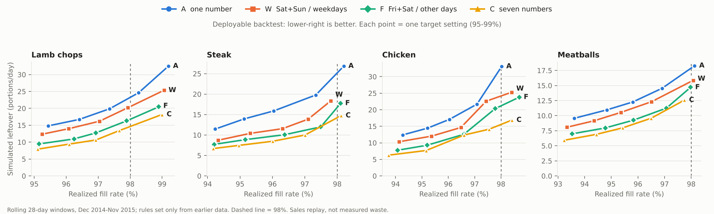

# Demand-Driven Production Planning

**Service-Level vs. Over-Preparation Tradeoffs in Perishable Food Operations**

A backtest of simple daily prep-quantity rules for a restaurant kitchen. The question is how much a demand-based prep rule helps, and when extra planning complexity pays off.

**Main results**

- **Deployable backtest (no hindsight):** every parameter is set from data before each test window. At the same preset target, a fixed two-number rule (Friday+Saturday vs. the other five days) matched a single number's realized fill within −0.4 to +0.7 points and left **6–39% fewer simulated leftover portions per day (median 33%)**. That holds in all 40 runs: 2 calibration methods × 5 targets × 4 main dishes.
- **Matched-fill comparison:** interpolated along each rule's out-of-sample curve to the same realized fill (~97%), the two-number rule leaves 23–41% less. The match point is picked after seeing test results, so this is an estimate, not a policy that was run.
- A 5% buffer brought the two-number rule to 98.2–98.6% realized fill against a 98% target. About 3 in 10 months still fell short, so this improves the annual service level; it does not remove monthly stockouts.



## Data

Daily portions sold for 7 dishes at one restaurant in Stuttgart, Germany, from 2013-10-04 to 2015-11-07 (760 trading days).
Source: Taigel & Meller, *Data for: Machine learning for inventory management*, Mendeley Data, DOI [10.17632/7s3ys9ntnz.1](https://data.mendeley.com/datasets/7s3ys9ntnz/1), CC BY 4.0.

`data/stuttgart_daily_sales.csv` holds the date and the seven sales columns extracted from the original `data_preprocessed.csv` (dates are `M.D.YYYY`). Column totals match the original file exactly.

**Important:** this is *sales*, not demand. On sold-out days true demand is unobserved. All leftovers are simulated (prep minus sales), not measured waste.

## Rules

Every rule sets a prep quantity per weekday group. The quantity is an empirical quantile (`inverted_cdf`, so always an observed sales value) of that group's past daily sales.

| Rule | Numbers | Grouping |
|---|---|---|
| A | 1 | every day the same |
| W | 2 | Sat+Sun vs. Mon–Fri (fixed) |
| F | 2 | Fri+Sat vs. other five days (fixed) |
| B | 2 | busiest *k* days vs. rest, *k* re-chosen each window on validation data |
| C | 7 | one per weekday |

## Method

- **Rolling backtest:** 13 test windows of 28 trading days starting 2014-11-29 (the last window has 4 days).
- **No look-ahead:** before each window, the safety level (quantile, and grouping for B) is chosen on the previous 56 trading days, with the rule fitted on data before those 56 days. The chosen rule is then refitted on all data before the window and frozen.
- **Choice rule:** the lowest quantile on the grid 0.50–1.00 (step 0.005) that meets the target on validation. 1.00 = historical maximum, the ceiling for every rule.
- **Metrics:** fill rate = Σ min(prep, sold) ÷ Σ sold (unit-weighted, pooled over windows); leftover = max(prep − sold, 0) and shortfall = max(sold − prep, 0), kept separate; share of Saturdays fully covered.
- **Coverage:** 340 trading days (2014-11-29 to 2015-11-07), identical for every dish and rule. Pooled results weight each day equally (and fill rate by units sold), so the final 4-day window counts as 4 days. "Windows below target" counts only the 12 full 28-day windows.
- **Calibration methods compared:** M1 quantile with 56-day validation; M2 = M1 plus a 5% buffer, `prep = ceil(quantile × 1.05)`, where the quantile is chosen first, without the buffer (sensitivity: 3%, 10%); M3 quantile with 112-day validation. Prep is rounded up to whole portions in every method; the batch-of-5 check rounds up to multiples of 5 instead.

## Two kinds of evidence, kept separate

| | Uses test-period data? | Read as |
|---|---|---|
| **Deployable backtest** (`deployable_backtest.csv`, `deployable_matched_fill.csv`) | No | what a manager could actually achieve |
| **Ex-post equal-fill comparison** (`expost_equal_fill.csv`) | Yes: picks the quantile that makes pooled test fill hit the target | where the gain comes from; not an operating result |

Between these sit two deployable-based views:

- `deployable_same_target_F_vs_A.csv`: F and A run at the same preset target. No hindsight at all; realized fills differ slightly, so the table reports the fill difference beside the leftover difference.
- `deployable_matched_fill.csv`: each rule's deployable runs (targets 95–99%, M1 and M2) form a curve of realized fill vs. leftover. Leftover is **linearly interpolated** on that curve at 96.5%, 97%, and 97.5% realized fill. Every point used lies inside every rule's observed range (92.3–99.6%), so nothing is extrapolated. The curve points come from pre-set rules, but the match level is chosen after seeing test results: read it as a standardized comparison, not as a policy that was run.

## Results

| Dish | A | W | F | B | C | F vs. A |
|---|---|---|---|---|---|---|
| Lamb chops | 18.4 | 16.1 | 12.8 | 12.4 | 10.8 | −30% |
| Steak | 18.4 | 13.6 | 11.2 | 11.3 | 10.0 | −39% |
| Chicken | 21.0 | 16.0 | 13.6 | 14.8 | 13.3 | −35% |
| Meatballs | 14.2 | 12.8 | 11.0 | 11.7 | 9.9 | −23% |

*Simulated leftover, portions/day, at 97% realized fill (deployable).*

- Re-choosing the busy days each month (B) did not beat fixing Fri+Sat (F). Month by month, B usually picked Saturday alone or Fri+Sat.
- Seven numbers (C) saved another 0–3 portions/day over F. Whether that is worth it depends on food cost, which this data lacks.
- Ex post at exactly 98% fill, F leaves 21–35% less than A (18–37% across targets of 95–99%).
- **Small dishes** (squid, fish, shrimp; 4–11 sold/day, `small_items_M1_98.csv`): same direction, F leaves 1–2 fewer portions/day than A. They are kept out of the headline because the gap is too small to matter once food is made in batches.
- **Calibration:** only the 5% buffer brought all four dishes to ≥98% realized fill (F: 98.2–98.6%), at about 2.4 extra portions/day. A longer validation window did not help. Even so, about 3 in 10 individual months fell short of 98%.
- **Ceiling:** with the quantile grid capped at 0.99, rule A misses 98% in 1–3 windows per dish. With the cap at the historical max, only steak in Dec 2014 misses (97.0%), because one 82-portion Saturday beat the prior record of 62 (`ceiling_check.csv`).

## Cost decision (no prices assumed)

Let *c_w* = cost of one leftover portion and *c_s* = cost of one portion short (lost margin plus goodwill).

- **Two numbers vs. one:** F cuts leftover by ΔL ≈ 1–13 portions/day (median 5.2) with shortfall within ±0.2 portions/day, so it pays whenever ΔL × *c_w* exceeds the effort of keeping a second number.
- **Seven numbers vs. two:** C saves another 0–3 portions/day; worth it only if that × *c_w* beats maintaining five more numbers.
- **5% buffer:** adds 1.9–2.8 leftovers/day to avoid 0.14–0.25 portions short/day (`buffer_tradeoff.csv`), i.e. 8–16 leftovers per shortfall avoided. Use it only if *c_s* / *c_w* > 8–16.

## Limits

One restaurant; sales, not demand; no cost data. The 13 windows share history and season, so they show consistency rather than independent repeats. Simple quantile rules lag trends: meatball sales rose in late 2015 and every rule fell behind.

## Reproduce

```bash
pip install -r requirements.txt
python3 run_all.py      # all tables -> results/ (about 2 minutes)
python3 make_chart.py   # results/tradeoff_chart.png
```

```
data/stuttgart_daily_sales.csv   7 dishes x 760 days
src/prep_sim.py                  rules, calibration, rolling backtest, metrics
src/expost.py                    ex-post equal-fill comparison
run_all.py                       every table
make_chart.py                    the chart
results/                         outputs (CSV + PNG + run_log.txt)
```

Scope: this is **daily preparation planning** for perishable dishes (the simulation assumes nothing carries over to the next day). It does not model purchasing lead times, stock carryover, or real inventory costs.

## Project history

- Round 1: single split; headline of "35–40% less leftover" **retracted**. It mostly came from the one-number rule picking a high safety level after an unusually busy validation period.
- Round 2: rolling backtest; ex-post 23–34% for B.
- Round 3 (this version): independent re-implementation. Reproduces round 2 (pooled deployable fill 95.8–98.3% at a 98% target; ex-post B within ~1 portion of round 2). Adds the fixed Fri+Sat rule, same-target and matched-fill deployable comparisons, calibration comparison, buffer cost tradeoff, small-dish results, and the ceiling check.
